# DualSense 本地查验助手

Windows 10/11 下的 DualSense 原装特征检查程序，四步中文桌面界面：连接与照片、官方软件、功能与标签、检查报告。选择背面照片并连接标准 DualSense，可运行本地 OCR、USB 只读检测及索尼官方软件窗口识别。

**不能认证正版。** VID/PID、照片、固件信息和 HID 协议都可能被仿造。本程序没有索尼签名认证或官方序列号数据库，不能识别所有高仿、换壳、拼装或翻新手柄。不输出虚假的真伪百分比。功能正常也不等于整机原装。

## 使用

安装 Windows 版 Python 3.11（包含 Tkinter 并加入 PATH），双击 `launch.cmd`。首次启动需联网从 PyPI 安装依赖；检测过程不上传照片或报告。

1. 用支持数据传输的 USB 线连接手柄，关闭可能独占 HID 的软件。
2. 选择背面照片。尽量让标签居中、清晰、无反光；支持 JPG、PNG、BMP。图像仅本地预览、OCR，不复制原图到项目。
3. 点击“一键检查”，可轻动摇杆。程序读取约 2 秒输入，不发送输出报告，不写校准或固件。
4. 检查 OCR 候选，必要时手动补充标签文字。候选是识别结果，不是正确性保证。当前不解码二维码，不读取内部生产序列号，不把 MAC 地址误当 17 位生产序列号。
5. 在“官方软件”页安装并打开[索尼官方 PlayStation Accessories](https://controller.dl.playstation.net/controller/lang/en/2100004.html)，点击“重新检查识别结果”。程序验证索尼可执行文件签名并读取其窗口中的 DualSense 名称及固件版本；未读到则保留未完成状态。完整检查也会读取已运行的官方软件。固件更新不是本工具的自动步骤。
6. 按[索尼官方说明](https://www.playstation.com/en-us/support/hardware/find-dualsense-controller-serial-number/)核对背面与包装标签。官方说明生产序列号为 17 位字母数字，可扫描背面二维码；有 PS5 时可在设置中查看序列号并比对。核对外观、购买渠道与售后记录。
7. 在“功能与标签”页，按指引实际测试并选择“未测试”“通过（本人确认）”“异常（本人确认）”或“不适用”。记录来源明确为用户，自动保存到本次本地报告，不作为自动认证。
8. “检查报告”汇总证据、官方版本及人工异常；可打开技术详情或报告目录。Ctrl+Enter 可启动完整检测，检测期间防止重复运行。选择新照片后需重新检测，旧报告不会假装来自新照片。

本地报告保存在 `private/report-*.json`。包含 OCR 序列号候选，分享前自行删去。`private/`、照片、日志、JSON、虚拟环境均被 Git 忽略。原始 HID 配对数据可能包含 MAC，程序只保存结构检查结果，不保存其原始字节、设备路径、MAC、主机名或用户名。报告由本地路径打开，不需要账号或 API 密钥。

命令行：

```powershell
.\.venv\Scripts\python.exe app.py --scan --photo "D:\photos\controller.jpg"
.\.venv\Scripts\python.exe -m unittest -v
```

## 检查规则与边界

仅支持 USB 标准 DualSense `054C:0CE6`，Windows HID 接口 3、usage page 1 / usage 5。Edge 和蓝牙不在本版本支持范围；未发现支持设备不等于假货。多设备分别记录，程序不能自动证明照片属于哪一个已连接设备；多设备时不会输出组合的“较强证据”结论。

只读 Feature Report：校准 `0x05/41`、配对 `0x09/20`、固件 `0x20/64`。验证 ID、长度与非零负载；不是密码学认证，也不是完整校准质量验证。固件字段按小端偏移 24/28/44 读取硬件、固件和 update version；update version 不应直接等同官方软件显示的版本字符串。USB 输入为 `0x01/64`，2 秒采样，单次读取超时 100ms。PnP 查询超时 30 秒。

协议依据：[Linux 上游 hid-playstation 驱动](https://github.com/torvalds/linux/blob/master/drivers/hid/hid-playstation.c)，由公开协议事实独立编写；未复制驱动代码。规则相符仍可能是仿真设备。错误或部分报告缺失归为“证据不足”，不得自动判假。

```mermaid
flowchart TD
    A[连接与照片] --> B[本地 OCR 和标签候选]
    A --> C[USB 枚举和只读报告]
    C --> D[实时输入采样]
    E[官方软件页] --> F[官网下载及用户安装]
    F --> G[签名校验后启动官方程序]
    G --> H[读取官方窗口名称和固件版本]
    D --> H
    H --> I{获得完整官方证据?}
    I -->|是| J[记录识别成功]
    I -->|否| K[保留失败原因和重试入口]
    B --> L[检查报告]
    J --> L
    K --> L
    M[功能与标签页人工操作] --> N[标明用户来源的核对记录]
    N --> L
    L --> O[本地保存和技术详情]
```



## 官方软件集成

`official_probe.ps1` 在独立 Windows PowerShell STA 子进程中运行，25 秒超时，只查询官方窗口及签名。默认位置为系统 Program Files 下 `Sony/PlayStationAccessories/PlayStationAccessories.exe`。未安装、未运行、未识别、签名异常、启动成功、读取失败分别记录；启动不等于识别成功。仅接受签名有效且签署方包含 Sony Interactive Entertainment 的文件，进程路径需与之相同。窗口解析目前支持简体中文和英文的标准 DualSense 名称、固件字符串；其他语言、Edge、自定义安装路径及隐藏/最小化窗口可能无法读取，按未完成处理。

Windows PowerShell 5.1 脚本使用 UTF-8 BOM；子进程清理继承的 PSModulePath，并在该子进程内处理 ObjectSecurity 类型数据重复加载问题，不更改系统设置或执行策略。若系统策略禁止脚本，界面保留失败提示，不自动绕过。官方程序和其安装包不包含在本项目内，安装流程由用户在官方向导完成。

完整检测中，单个 USB 手柄报告一致且官方窗口单个 DualSense 被识别时，显示“较强证据支持原装特征”；这仍是软件特征推断，不是认证。报告时间保留 UTC；单独刷新官方结果另记检查时间。人工项目不冒充自动实测；不能通过这些数据排除换壳、维修或翻新。

## 界面设计依据

- [RISD Graphic Design](https://www.risd.edu/academics/graphic-design)：将字体、图像、网格和系统作为视觉传达的基础。这里采用对齐的工作区、三级字号与原创手柄示意图。
- [RISD 视觉设计学习资料](https://artsandlanguage.risd.edu/quick-guides)：参考视觉层级、网格、色彩和信息设计主题来组织四步任务。
- [Linear 官方界面设计文章](https://linear.app/now/behind-the-latest-design-refresh)：参考降低导航干扰、稳定操作位置、减少视觉竞争的思路。未复制品牌素材或页面代码，也不声称是其官方产品。

`ui.py` 使用系统中文字体、雾白工作区、深蓝流程导航、蓝色主按钮和绿色证据状态。界面与硬件逻辑分离，后台任务经队列回传主线程。窗口最小 1060×760，固定逻辑字号以避免 Windows 高缩放时内容截断。技术 JSON 仅在详情窗口显示。依赖没有新增外部 UI 框架、CDN 或遥测。字体和配色由本项目独立实现。

## 实测与开发记录（UTC+08:00，最新在前）

- 2026-11-03 11:10:56 +08:00：更新 `app.py`、`launch.cmd`、`test_app.py`、本 README，新增 `ui.py`、`official_probe.ps1`。整合四步流程、官方签名与窗口读取、错误重试、人工核对及报告；重做界面并更新 Mermaid。11 项测试通过，四页实际渲染截图已本地检查，GUI 完整运行检测、队列回传、报告保存及人工记录持久化通过，官方软件签名检查和启动成功实测；此次未连接 USB 手柄，端到端检查验证了未连接降级，不能将前一次手柄实测冒充新版连接实测。此前本会话独立读取官方窗口得到 DualSense、固件 B-0630、最新；本次自动化重构后尚未再次验证连接时识别。照片、截图和本机报告不公开。

- 2026-11-03 10:43:00 +08:00：新建 `app.py`、`launch.cmd`、`requirements.txt`、`test_app.py`、`.gitignore` 和本 README，实现照片本地 OCR、USB 只读检查、中文 GUI、本地报告与失败降级。对一台实际连接手柄读取 41/20/64 字节特征报告成功，2 秒取得 500 个 64 字节 USB 输入报告；PnP HID/MEDIA/USB 状态正常。固件原始字段硬件 `0x1107`、固件 `0x110002a`、update version `1584`，构建日期 2025-07-04。照片 OCR 实际运行成功，但漏读型号且出现序列号字符误识别，保留人工核对。官方安装包 Authenticode 签名 Valid，签署方 Sony Interactive Entertainment LLC；已尝试启动安装，用户反馈“安装或识别失败”，因此官方识别未通过验证。未执行固件更新、游戏功能测试或内部生产序列号对比。5 项单元测试通过，实际应用 GUI 启动和关闭冒烟检查通过；暂存文件敏感信息扫描通过；不将自动测试视为索尼认证。实机照片与报告不公开。
