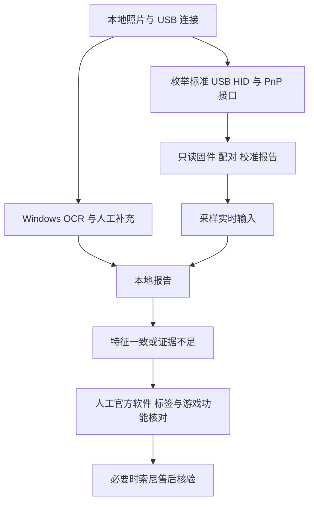

# DualSense 本地查验助手

Windows 10/11 下的 DualSense 原装特征检查程序，中文桌面界面。选择背面照片、通过 USB 连接标准 DualSense，点击一次即可运行本地 OCR、USB 接口查询、固件/配对/校准报告读取与实时输入采样。

**不能认证正版。** VID/PID、照片、固件信息和 HID 协议都可能被仿造。本程序没有索尼签名认证或官方序列号数据库，不能识别所有高仿、换壳、拼装或翻新手柄。不输出虚假的真伪百分比。功能正常也不等于整机原装。

## 使用

安装 Windows 版 Python 3.11（包含 Tkinter 并加入 PATH），双击 `launch.cmd`。首次启动需联网从 PyPI 安装依赖；检测过程不上传照片或报告。

1. 用支持数据传输的 USB 线连接手柄，关闭可能独占 HID 的软件。
2. 选择背面照片。尽量让标签居中、清晰、无反光；支持 JPG、PNG、BMP。图像仅本地预览、OCR，不复制原图到项目。
3. 点击“一键检查”，可轻动摇杆。程序读取约 2 秒输入，不发送输出报告，不写校准或固件。
4. 检查 OCR 候选，必要时手动补充标签文字。候选是识别结果，不是正确性保证。当前不解码二维码，不读取内部生产序列号，不把 MAC 地址误当 17 位生产序列号。
5. 打开[索尼官方 PlayStation Accessories](https://controller.dl.playstation.net/controller/lang/en/2100004.html)，安装后查看是否识别、显示什么版本。程序不会把打开网页当作识别成功。固件更新不是本工具的自动步骤。
6. 按[索尼官方说明](https://www.playstation.com/en-us/support/hardware/find-dualsense-controller-serial-number/)核对背面与包装标签。官方说明生产序列号为 17 位字母数字，可扫描背面二维码；有 PS5 时可在设置中查看序列号并比对。核对外观、购买渠道与售后记录。
7. 在支持相应功能的游戏中人工测试触觉反馈、自适应扳机、触摸板、陀螺仪和音频。此项依赖游戏支持及人工操作，程序不声称自动完成。

本地报告保存在 `private/report-*.json`。包含 OCR 序列号候选，分享前自行删去。`private/`、照片、日志、JSON、虚拟环境均被 Git 忽略。原始 HID 配对数据可能包含 MAC，程序只保存结构检查结果，不保存其原始字节、设备路径、MAC、主机名或用户名。报告由本地路径打开，不需要账号或 API 密钥。

命令行：

```powershell
.\.venv\Scripts\python.exe app.py --scan --photo "D:\photos\controller.jpg"
.\.venv\Scripts\python.exe -m unittest -v
```

## 检查规则与边界

仅支持 USB 标准 DualSense `054C:0CE6`，Windows HID 接口 3、usage page 1 / usage 5。Edge 和蓝牙不在本版本支持范围；未发现支持设备不等于假货。多设备分别记录，结果代表其中至少一个设备符合协议特征；程序不能自动证明照片属于哪一个已连接设备。

只读 Feature Report：校准 `0x05/41`、配对 `0x09/20`、固件 `0x20/64`。验证 ID、长度与非零负载；不是密码学认证，也不是完整校准质量验证。固件字段按小端偏移 24/28/44 读取硬件、固件和 update version；update version 不应直接等同官方软件显示的版本字符串。USB 输入为 `0x01/64`，2 秒采样，单次读取超时 100ms。PnP 查询超时 30 秒。

协议依据：[Linux 上游 hid-playstation 驱动](https://github.com/torvalds/linux/blob/master/drivers/hid/hid-playstation.c)，由公开协议事实独立编写；未复制驱动代码。规则相符仍可能是仿真设备。错误或部分报告缺失归为“证据不足”，不得自动判假。



## 实测与开发记录（UTC+08:00，最新在前）

- 2026-11-03 10:43:00 +08:00：新建 `app.py`、`launch.cmd`、`requirements.txt`、`test_app.py`、`.gitignore` 和本 README，实现照片本地 OCR、USB 只读检查、中文 GUI、本地报告与失败降级。对一台实际连接手柄读取 41/20/64 字节特征报告成功，2 秒取得 500 个 64 字节 USB 输入报告；PnP HID/MEDIA/USB 状态正常。固件原始字段硬件 `0x1107`、固件 `0x110002a`、update version `1584`，构建日期 2025-07-04。照片 OCR 实际运行成功，但漏读型号且出现序列号字符误识别，保留人工核对。官方安装包 Authenticode 签名 Valid，签署方 Sony Interactive Entertainment LLC；已尝试启动安装，用户反馈“安装或识别失败”，因此官方识别未通过验证。未执行固件更新、游戏功能测试或内部生产序列号对比。5 项单元测试通过，实际应用 GUI 启动和关闭冒烟检查通过；暂存文件敏感信息扫描通过；不将自动测试视为索尼认证。实机照片与报告不公开。
